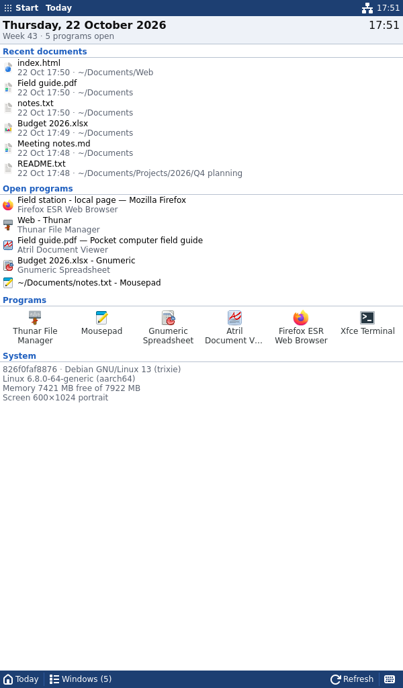
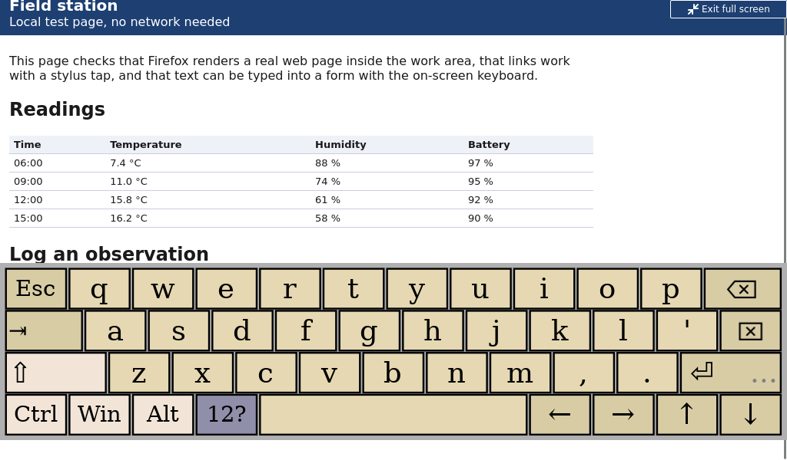

# pda-shell

Proof of concept of a stylus-first, Pocket PC inspired shell for a pocket
Linux computer (5" 1024×600 resistive touchscreen), running real desktop
applications. `pda-shell` is a temporary internal name.

Stack: Debian 13, X11, Openbox, Rust + GTK 4 (gtk-rs), Onboard, x11rb for EWMH.


## Status

POC 0.2: real desktop programs (Thunar, Gnumeric, Mousepad, Atril, Firefox
ESR) are edited, saved and reopened **with the pointer and the on-screen
keyboard only**, in both orientations, by an automated end-to-end test.
Milestones 1–3 and 5–7 are done as far as possible without the real panel;
Milestone 4 (system-wide stylus input) waits for the hardware.

- [docs/test-results.md](docs/test-results.md): what was run, results by
  category, and the recommendation (orientation, density, next steps).
- [docs/known-limitations.md](docs/known-limitations.md): status per item
  (automated / demonstrated / unit-tested / unverified) and where the
  desktop-application approach breaks down.
- [docs/ergonomics.md](docs/ergonomics.md): physical sizes on the 5" 237 ppi
  panel and the density profiles.
- [docs/screenshots.md](docs/screenshots.md): screenshot index.

## Run it on Debian 13

```bash
./scripts/setup-debian.sh                          # once: toolchain, Xephyr, Openbox, apps
./scripts/dev-session.sh --orientation portrait    # 600×1024 window
./scripts/dev-session.sh --orientation landscape   # 1024×600 window
./scripts/dev-session.sh --density readable        # larger density profile
./scripts/dev-session.sh --reset-home              # fresh sample documents
```

The session opens in a Xephyr window inside your normal desktop. It has its
own display, D-Bus bus and HOME (`.dev-session/home`, seeded with sample
files and default file associations), so it does not touch your desktop or
settings. `--home DIR` uses another session HOME. Close the Xephyr
window, press Ctrl+C in the terminal, or use **Start → End session** (which
closes programs the normal way first) to leave. Logs:
`.dev-session/logs/latest/` (`session.log`, `shell.log`, `openbox.log`,
`xserver.log`).

Useful options: `--headless` (Xvfb, no window), `--release`, `--no-build`.

## Run it on another OS (e.g. macOS)

A Debian 13 container built from the same setup script:

```bash
./scripts/container.sh build                  # build the image
./scripts/container.sh cargo test             # unit + integration tests
./scripts/container.sh ./scripts/smoke-test.sh
./scripts/container.sh vnc portrait           # then open vnc://localhost:5900
```

## Tests

```bash
cargo test                       # unit + integration tests (state machine, layout, config, …)
./scripts/smoke-test.sh          # shell behaviour in both orientations (Xvfb + Openbox + real apps)
./scripts/app-workflow-test.sh   # real-program workflow, pointer and on-screen keyboard only
```

The **smoke test** checks the shell itself: struts and work area, Start menu
search and launching, maximized programs, the switcher, Today, long press,
closing a program and ending the session without leftovers. It types the
Start menu search with synthetic key events.

The **workflow test** is the POC 0.2 acceptance test. After the session
starts it only taps: shell buttons, application toolbars and menus, and the
keys of the on-screen keyboard (`scripts/lib/pda_ui.py` computes Onboard's
key positions with Onboard's own layout code). It opens the spreadsheet
from Thunar, edits it in Gnumeric with numbers, a formula and text, saves,
edits and saves a text file in Mousepad, uses the switcher, pages through
the PDF in Atril, fills a form in Firefox, takes Firefox to full screen with
F11 and back with the shell's escape button, reopens both documents from
Today, opens context menus near the screen edges, and ends the session with
unsaved work (which must be asked about, not discarded). Saved files are
checked on disk. Screenshots land in `screenshots/workflow/`.

`./scripts/make-sample-files.py` regenerates the sample documents.

## Configuration

`config/pda-shell.toml`: every size, colour and input threshold (long-press
600 ms, 8 px slop, …), density profiles (`[density.compact|balanced|readable]`),
Today shortcuts, keyboard command and layout, Start menu filtering, full-screen
policy and dialog fitting. Session-local edits of Today shortcuts are saved to
`$XDG_CONFIG_HOME/pda-shell/today-shortcuts`.
`config/openbox/rc.xml`: window-manager rules (maximize and undecorate
ordinary application windows). `config/home/`: defaults copied into a new
session HOME (file associations, Thunar list view with single-tap open).
`scripts/bin/pda-onboard`: starts Onboard with a fix for symbol keys on
Debian 13 (see the script).

## Layout

```text
src/
  main.rs, lib.rs, config.rs
  shell/      state machine (state.rs), layout.rs, shortcuts.rs, controller (mod.rs)
  ui/         status_bar/, command_bar/, today/, start_menu/, escape.rs, shared widgets + CSS
  apps/       desktop entries, search, launching
  input/      gesture recognizer (gesture.rs) + GTK long-press feedback
  keyboard/   Onboard control
  platform/   neutral window types; x11/ = all X11/EWMH code
scripts/      setup-debian.sh, dev-session.sh, smoke-test.sh, app-workflow-test.sh,
              container.sh, make-sample-files.py, bin/pda-onboard, lib/pda_ui.py
config/       pda-shell.toml, openbox/rc.xml, home/ (session HOME defaults)
assets/       sample-files/ (documents copied into the session HOME)
docs/         architecture, hardware, UX principles, ergonomics, test results,
              screenshots, known limitations
tests/        usability_flow.rs
screenshots/  captured from the running implementation
```

## Screenshots

All captured from the running implementation (Xvfb, Openbox, real
programs) while the workflow test drove it with taps; index and density
comparisons in [docs/screenshots.md](docs/screenshots.md).

| | |
|---|---|
|  |  |
| Gnumeric, portrait, edited with the on-screen keyboard | Today with five programs open |
|  |  |
| Mousepad, landscape, keyboard open | Firefox full screen with the shell's "Exit full screen" |
