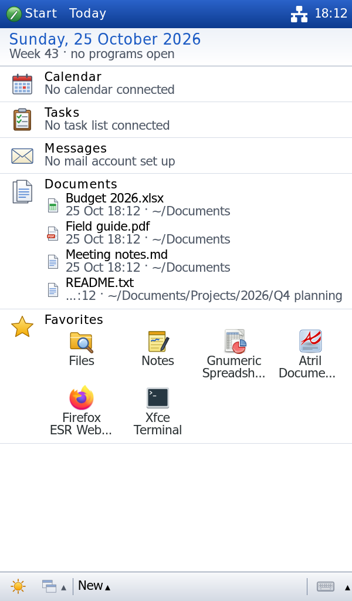
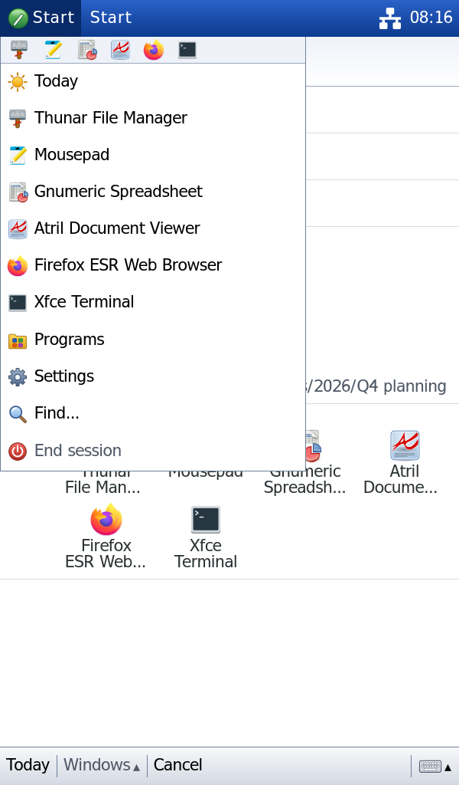
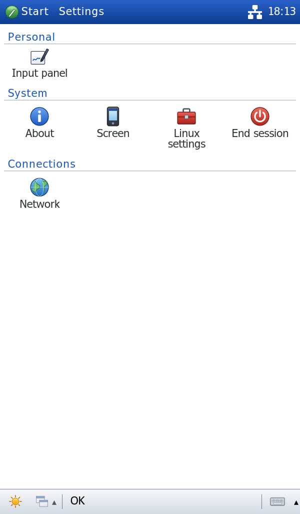
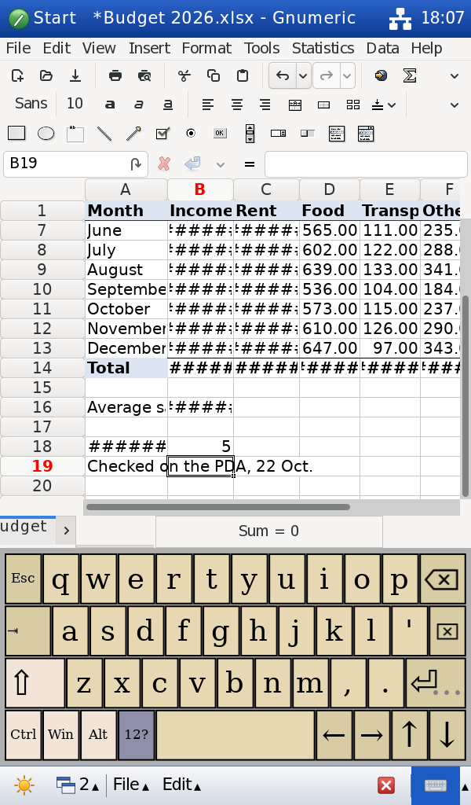
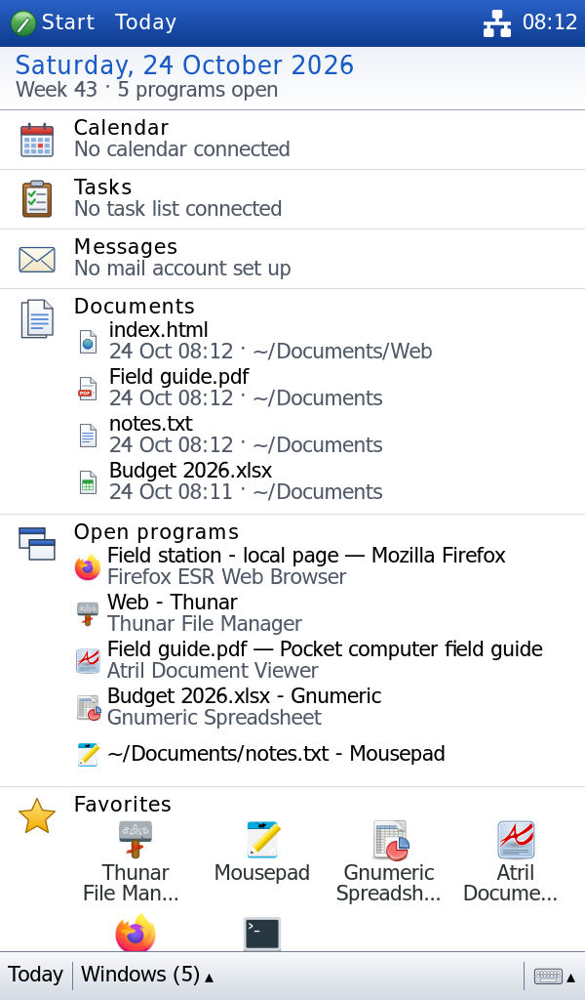
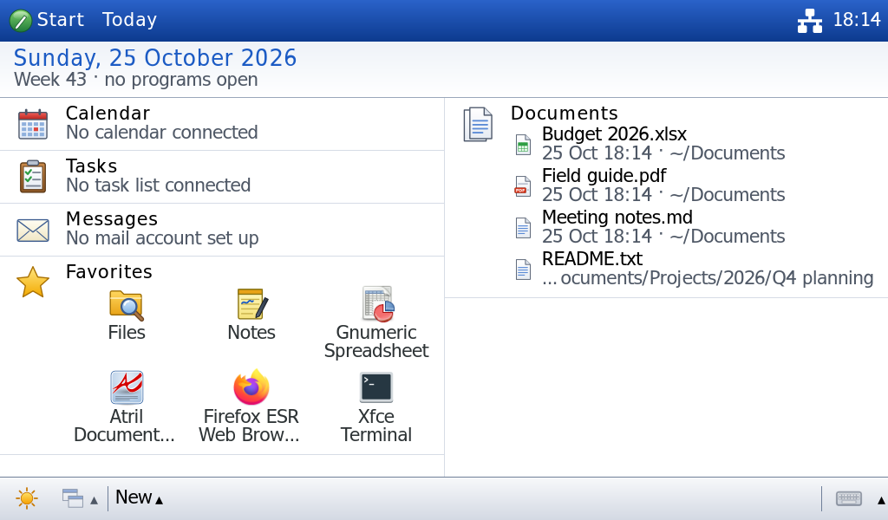
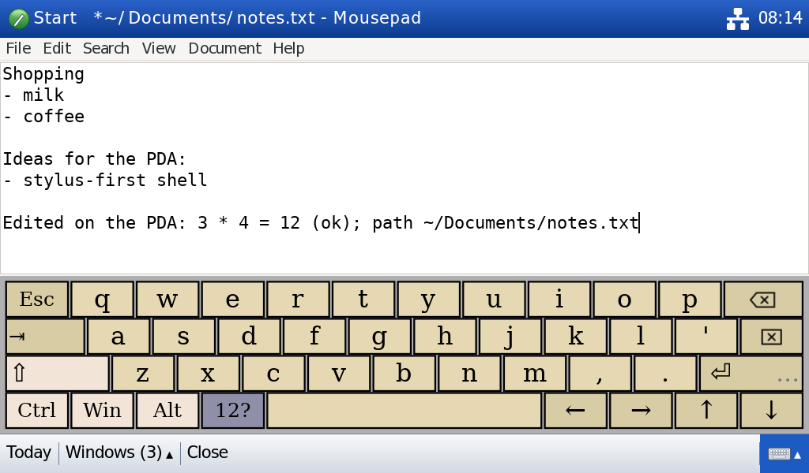

# pda-shell

Proof of concept of a stylus-first shell in the style of Pocket PC 2003 SE
for a pocket Linux computer (5" 1024×600 resistive touchscreen), running
real desktop applications. `pda-shell` is a temporary internal name.

Stack: Debian 13, X11, Openbox, Rust + GTK 4 (gtk-rs), Onboard, x11rb for EWMH.

| | | |
|---|---|---|
|  |  |  |
| Today | Start | Settings |

## Status

POC 0.3 (issue #4, P0 slice): a coherent Pocket PC 2003 SE-style
experience. Device-scale `pocketpc` density profile (22 px text, 46 px
targets) as the default, the same scale applied session-wide to programs
(XSETTINGS DPI and font), a glanceable Today, a compact Start drop-down,
Programs and Settings screens (system details moved to Settings → About),
a blue status bar and silver menu bar, Wine's Tahoma clone and an original
colored icon set. Before/after screenshots:
[docs/screenshots.md](docs/screenshots.md).

P1 and P2: the command bar shows the program's own menus (any
GtkApplication menu bar, e.g. Mousepad's; see
[docs/command-bar-api.md](docs/command-bar-api.md)) or generic File/Edit
commands, and New on Today; native **Files** and **Notes** programs, with
Thunar and Mousepad under Programs → Linux tools; a built-in Pocket PC
style input panel next to Onboard. Not done: any assessment on the
physical panel.

POC 0.2: real desktop programs (Thunar, Gnumeric, Mousepad, Atril, Firefox
ESR) are edited, saved and reopened **with the pointer and the on-screen
keyboard only**, in both orientations, by an automated end-to-end test.
Milestones 1–3 and 5–7 are done as far as possible without the real panel;
Milestone 4 (system-wide stylus input) waits for the hardware.

- [docs/test-results.md](docs/test-results.md): what was run, results by
  category, and the recommendation (orientation, density, next steps).
- [docs/known-limitations.md](docs/known-limitations.md): status per item
  (automated / demonstrated / unit-tested / unverified) and where the
  desktop-application approach breaks down.
- [docs/ergonomics.md](docs/ergonomics.md): physical sizes on the 5" 237 ppi
  panel and the density profiles.
- [docs/screenshots.md](docs/screenshots.md): screenshot index.

## Run it on Debian 13

```bash
./scripts/setup-debian.sh                          # once: toolchain, Xephyr, Openbox, apps
./scripts/dev-session.sh --orientation portrait    # 600×1024 window
./scripts/dev-session.sh --orientation landscape   # 1024×600 window
./scripts/dev-session.sh --density compact         # another density profile
./scripts/dev-session.sh --reset-home              # fresh sample documents
```

The session opens in a Xephyr window inside your normal desktop. It has its
own display, D-Bus bus and HOME (`.dev-session/home`, seeded with sample
files and default file associations), so it does not touch your desktop or
settings. `--home DIR` uses another session HOME. Close the Xephyr
window, press Ctrl+C in the terminal, or use **Start → End session** (which
closes programs the normal way first) to leave. Logs:
`.dev-session/logs/latest/` (`session.log`, `shell.log`, `openbox.log`,
`xserver.log`).

Useful options: `--headless` (Xvfb, no window), `--release`, `--no-build`.

`setup-debian.sh` also installs `fonts-wine` and registers its Tahoma clone
with fontconfig (the shell's and the programs' font); rerun it (or
`./scripts/container.sh build`) after updating from POC 0.2.

## Run it on the device

On a Debian 13 board with the HDMI panel (Orange Pi 3 LTS / Zero 2W),
without a desktop environment, started at boot:

```bash
sudo ./scripts/setup-debian.sh --device       # Xorg, libinput, touchscreen tools, programs
sudo ./scripts/install-device.sh --enable     # build, install to /opt/pda-shell, systemd unit on tty7
```

Or from a console login: `./scripts/device-session.sh [--orientation portrait] [--mode 800x480]`.
Screen output, mode and rotation come from `[device]` in the config;
nothing assumes 1024×600. Board selection, boot configuration and
troubleshooting: [docs/device-setup.md](docs/device-setup.md); the physical
test checklist: [docs/device-checklist.md](docs/device-checklist.md).
`./scripts/device-bench.sh --attach` measures startup, memory, CPU and
program launch times on the board.

## Run it on another OS (e.g. macOS)

A Debian 13 container built from the same setup script:

```bash
./scripts/container.sh build                  # build the image
./scripts/container.sh cargo test             # unit + integration tests
./scripts/container.sh ./scripts/smoke-test.sh
./scripts/container.sh vnc portrait           # then open vnc://localhost:5900 (password: pda)
```

## Tests

```bash
cargo test                       # unit + integration tests (state machine, layout, config, …)
./scripts/smoke-test.sh          # shell behaviour in both orientations (Xvfb + Openbox + real apps)
./scripts/app-workflow-test.sh   # real-program workflow, pointer and on-screen keyboard only
./scripts/device-test.sh         # the device session on Xvfb: 1024x600, 600x1024, 800x480,
                                 # crash recovery, End session with unsaved work
```

The **smoke test** checks the shell itself: struts and work area, Start menu
search and launching, maximized programs, the switcher, Today, long press,
closing a program and ending the session without leftovers. It types the
Start menu search with synthetic key events.

The **workflow test** is the POC 0.2 acceptance test. After the session
starts it only taps: shell buttons, application toolbars and menus, and the
keys of the on-screen keyboard (`scripts/lib/pda_ui.py` computes Onboard's
key positions with Onboard's own layout code). It opens the spreadsheet
from Thunar, edits it in Gnumeric with numbers, a formula and text, saves,
edits and saves a text file in Mousepad, uses the switcher, pages through
the PDF in Atril, fills a form in Firefox, takes Firefox to full screen with
F11 and back with the shell's escape button, reopens both documents from
Today, opens context menus near the screen edges, and ends the session with
unsaved work (which must be asked about, not discarded). Saved files are
checked on disk. Screenshots land in `screenshots/workflow/`. In landscape
the web form is below the fold at device scale; the test scrolls it into
view with the mouse wheel, standing in for a stylus scroll.

`./scripts/capture-screens.sh` captures the shell screens (Today, Start,
Programs, Settings, About, Screen, Find, keyboard) in both orientations into
`screenshots/pocketpc/`.

`./scripts/make-sample-files.py` regenerates the sample documents.

## Configuration

`config/pda-shell.toml`: every size, colour and input threshold (long-press
600 ms, 8 px slop, …), density profiles
(`[density.compact|balanced|readable|pocketpc]`, `pocketpc` selected),
the programs' DPI and font (`app_dpi`, `app_font`), the input panel
(`[keyboard] panel`: `onboard` or the built-in `pocketpc`), favorites, keyboard command and layout, Start menu filtering, full-screen
policy and dialog fitting. Session-local edits of the favorites are saved to
`$XDG_CONFIG_HOME/pda-shell/today-shortcuts`.
`config/share/applications/`: desktop entries of the native programs (the
session puts `config/share` on `XDG_DATA_DIRS` and the build directory on
`PATH`). `config/dconf/`, `config/firefox/`: defaults for desktop programs
installed by `setup-debian.sh`. `config/openbox/rc.xml`: window-manager rules (maximize and undecorate
ordinary application windows). `config/home/`: defaults copied into a new
session HOME (file associations, Thunar list view with single-tap open).
`scripts/bin/pda-onboard`: starts Onboard with a fix for symbol keys on
Debian 13 (see the script).

## Layout

```text
src/
  main.rs, lib.rs, config.rs
  shell/      state machine (state.rs), layout.rs, shortcuts.rs, controller (mod.rs)
  ui/         status_bar/, command_bar/ (menus.rs: program menus), today/, start_menu/,
              programs.rs, settings/, sip.rs (input panel), escape.rs, shared widgets + CSS
  native/     first-party programs: files.rs, notes.rs (binaries in src/bin/)
  apps/       desktop entries, search, launching
  input/      gesture recognizer (gesture.rs) + GTK long-press feedback
  keyboard/   Onboard control
  platform/   neutral window types; x11/ = all X11/EWMH code, XSETTINGS (settings.rs),
              XTEST typing (keys.rs)
  device/     physical device layer, no GTK: display plan from xrandr (display.rs),
              system and power facts (system.rs); binary: src/bin/pda-device.rs
scripts/      setup-debian.sh, dev-session.sh, smoke-test.sh, app-workflow-test.sh,
              capture-screens.sh, capture-profiles.sh, container.sh,
              make-sample-files.py, bin/pda-onboard, lib/pda_ui.py;
              device: device-session.sh, install-device.sh, device-test.sh, device-bench.sh
config/       pda-shell.toml, openbox/rc.xml, home/ (session HOME defaults),
              device/ (systemd unit)
assets/       icons/ (the shell's original icon set), sample-files/ (documents copied
              into the session HOME)
docs/         architecture, hardware, UX principles, ergonomics, test results,
              screenshots, known limitations
tests/        usability_flow.rs
screenshots/  captured from the running implementation
```

## Screenshots

All captured from the running implementation (Xvfb, Openbox, real
programs) while the tests drove it with taps; index and POC 0.2 → 0.3
before/after comparison in [docs/screenshots.md](docs/screenshots.md).

| | |
|---|---|
|  |  |
| Gnumeric, portrait, edited with the on-screen keyboard | Today with five programs open |
|  |  |
| Today, landscape | Mousepad, landscape, keyboard open |
