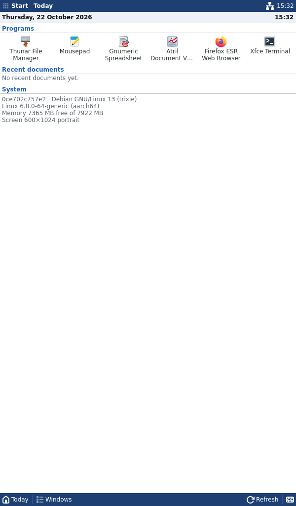
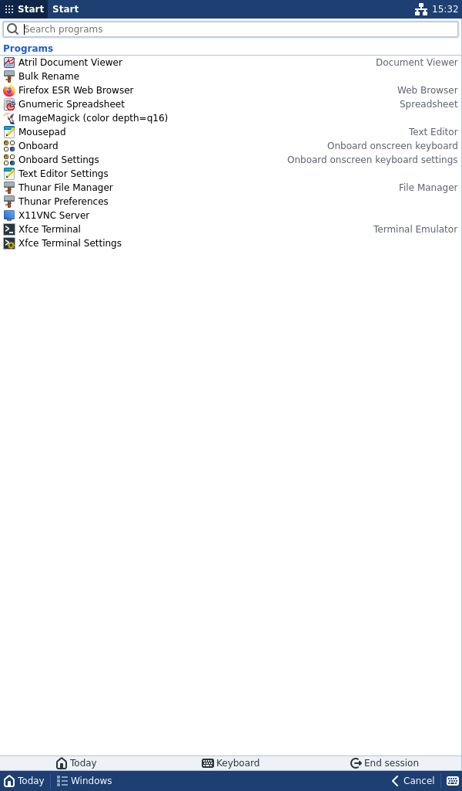
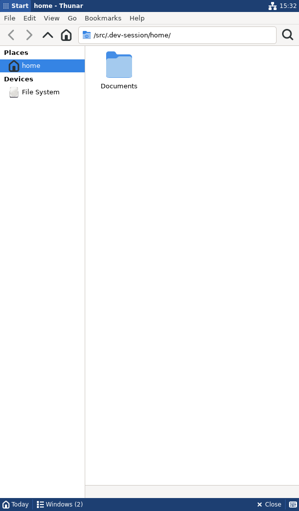
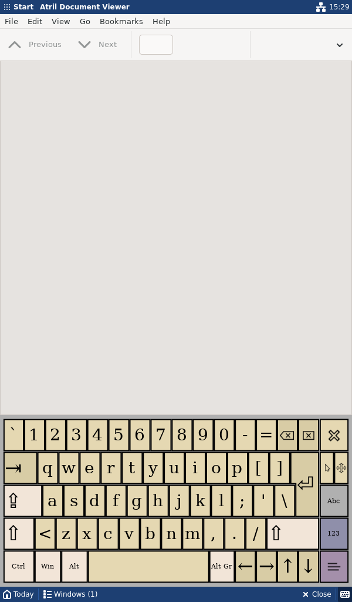

# pda-shell

Proof of concept of a stylus-first, Pocket PC inspired shell for a pocket
Linux computer (5" 1024×600 resistive touchscreen), running real desktop
applications. `pda-shell` is a temporary internal name.

Stack: Debian 13, X11, Openbox, Rust + GTK 4 (gtk-rs), Onboard, x11rb for EWMH.



## Status

Milestones 1 (development environment) and 2 (core shell) are working, plus
the in-shell part of the stylus model (long press) and a first Onboard
integration. See [docs/known-limitations.md](docs/known-limitations.md) for
exactly what was verified and what is not done.

## Run it on Debian 13

```bash
./scripts/setup-debian.sh                          # once: toolchain, Xephyr, Openbox, apps
./scripts/dev-session.sh --orientation portrait    # 600×1024 window
./scripts/dev-session.sh --orientation landscape   # 1024×600 window
```

The session opens in a Xephyr window inside your normal desktop. It has its
own display, D-Bus bus and HOME (`.dev-session/home`, seeded with sample
files), so it does not touch your desktop or settings. Close the Xephyr
window, press Ctrl+C in the terminal, or use **Start → End session** (which
closes programs the normal way first) to leave. Logs:
`.dev-session/logs/latest/` (`session.log`, `shell.log`, `openbox.log`,
`xserver.log`).

Useful options: `--headless` (Xvfb, no window), `--release`, `--no-build`.

## Run it on another OS (e.g. macOS)

A Debian 13 container built from the same setup script:

```bash
./scripts/container.sh build                  # build the image
./scripts/container.sh cargo test             # unit + integration tests
./scripts/container.sh ./scripts/smoke-test.sh
./scripts/container.sh vnc portrait           # then open vnc://localhost:5900
```

## Tests

```bash
cargo test                    # 65 tests: state machine, layout, gestures, search, config, …
./scripts/smoke-test.sh       # 54 end-to-end checks in both orientations (Xvfb + Openbox + real apps)
```

The smoke test starts a headless session, then drives it with synthetic
pointer events: checks the struts and work area, opens the Start menu,
searches and launches Mousepad and Thunar, verifies they are maximized
between the bars, switches through the switcher, returns to Today,
long-presses a shortcut for its context menu, closes a program from the
command bar, and ends the session, checking that no process is left over.
Screenshots land in `screenshots/smoke/`.

## Configuration

`config/pda-shell.toml`: every size, colour and input threshold (long-press
600 ms, 8 px slop, …), Today shortcuts, keyboard command. Session-local edits
of Today shortcuts are saved to `$XDG_CONFIG_HOME/pda-shell/today-shortcuts`.
`config/openbox/rc.xml`: window-manager rules (maximize and undecorate
ordinary application windows).

## Layout

```text
src/
  main.rs, lib.rs, config.rs
  shell/      state machine (state.rs), layout.rs, shortcuts.rs, controller (mod.rs)
  ui/         status_bar/, command_bar/, today/, start_menu/, shared widgets + CSS
  apps/       desktop entries, search, launching
  input/      gesture recognizer (gesture.rs) + GTK long-press feedback
  keyboard/   Onboard control
  platform/   neutral window types; x11/ = all X11/EWMH code
scripts/      setup-debian.sh, dev-session.sh, smoke-test.sh, container.sh
config/       pda-shell.toml, openbox/rc.xml
docs/         architecture, hardware, UX principles, known limitations
tests/        usability_flow.rs
screenshots/  captured from the running implementation
```

## Screenshots

All captured from the running shell (Xvfb, Openbox, real applications):

| | |
|---|---|
|  |  |
| Today, portrait | Start menu, portrait |
|  |  |
| Thunar maximized between the bars | Onboard above the command bar |

More in [screenshots/](screenshots/): landscape Today and Start menu,
switcher, long-press progress and context menu, keyboard in landscape.
Spreadsheet and PDF screenshots come with Milestone 3.
