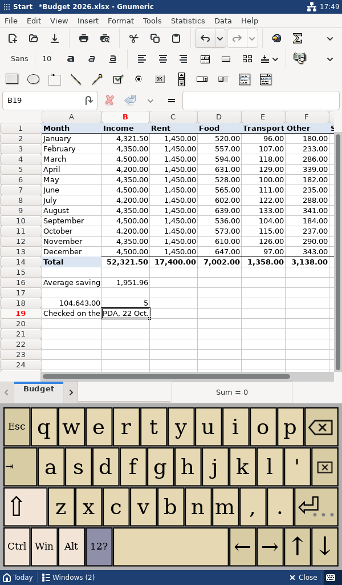
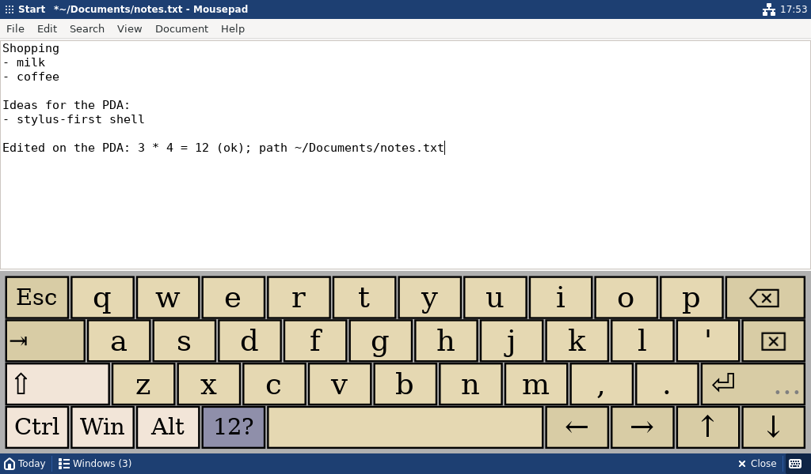

# Screenshots

Every screenshot was taken from the running implementation: the nested X11
session (Xvfb + Openbox, Debian 13) with the real programs, at exactly
600×1024 or 1024×600. None is a mock-up.

How they were made:

- `screenshots/apps/` and `screenshots/readable/`: by
  `scripts/app-workflow-test.sh` while it drove the session with pointer taps
  and the on-screen keyboard (compact profile, and `--density readable`).
- `screenshots/profiles/`: by `scripts/capture-profiles.sh`.

Before each screenshot the pointer is parked on the status bar title, so a
tooltip from the last tap does not cover the screen. On the device the
stylus leaves the pointer where it tapped and tooltips will appear (see
[known-limitations.md](known-limitations.md)).

Viewed 1:1 on a desktop monitor these are 2.2–2.6× larger than on the 5"
panel; see [ergonomics.md](ergonomics.md).

## Real applications (compact profile)

| What | Portrait 600×1024 | Landscape 1024×600 |
|---|---|---|
| Today in a fresh session: documents first | [portrait-01](../screenshots/apps/portrait-01-today.png) | [landscape-01](../screenshots/apps/landscape-01-today.png) |
| Thunar, Documents (list view, single tap opens) | [portrait-02](../screenshots/apps/portrait-02-thunar-documents.png) | [landscape-02](../screenshots/apps/landscape-02-thunar-documents.png) |
| Thunar six folders deep, long and non-ASCII names | [portrait-03](../screenshots/apps/portrait-03-thunar-long-names.png) | [landscape-03](../screenshots/apps/landscape-03-thunar-long-names.png) |
| Gnumeric with `Budget 2026.xlsx` | [portrait-04](../screenshots/apps/portrait-04-gnumeric.png) | [landscape-04](../screenshots/apps/landscape-04-gnumeric.png) |
| **Gnumeric, keyboard open**, after typing a number, a formula and text | [portrait-05](../screenshots/apps/portrait-05-gnumeric-keyboard.png) | [landscape-05](../screenshots/apps/landscape-05-gnumeric-keyboard.png) |
| Save As with the keyboard open (fitted dialog; see limitations) | [portrait-05b](../screenshots/apps/portrait-05b-save-as-dialog.png) | [landscape-05b](../screenshots/apps/landscape-05b-save-as-dialog.png) |
| Switcher | [portrait-06](../screenshots/apps/portrait-06-switcher.png) | [landscape-06](../screenshots/apps/landscape-06-switcher.png) |
| **Mousepad, keyboard open**, after typing a line | [portrait-07](../screenshots/apps/portrait-07-mousepad-keyboard.png) | [landscape-07](../screenshots/apps/landscape-07-mousepad-keyboard.png) |
| "Close all" armed by the first tap | [portrait-08](../screenshots/apps/portrait-08-switcher-close-all-armed.png) | [landscape-08](../screenshots/apps/landscape-08-switcher-close-all-armed.png) |
| Atril, `Field guide.pdf` page 2 of 4 | [portrait-09](../screenshots/apps/portrait-09-atril.png) | [landscape-09](../screenshots/apps/landscape-09-atril.png) |
| Firefox, local page, form typed with the keyboard | [portrait-10](../screenshots/apps/portrait-10-firefox-form.png) | [landscape-10](../screenshots/apps/landscape-10-firefox-form.png) |
| Firefox full screen (F11) with "Exit full screen" | [portrait-11](../screenshots/apps/portrait-11-fullscreen-escape.png) | [landscape-11](../screenshots/apps/landscape-11-fullscreen-escape.png) |
| Today with five programs open | [portrait-12](../screenshots/apps/portrait-12-today-with-apps.png) | [landscape-12](../screenshots/apps/landscape-12-today-with-apps.png) |
| Gnumeric reopened from Today after saving | [portrait-13](../screenshots/apps/portrait-13-gnumeric-reopened.png) | [landscape-13](../screenshots/apps/landscape-13-gnumeric-reopened.png) |
| Context menu from a long press at the right edge | [portrait-14](../screenshots/apps/portrait-14-context-menu-edge.png) | [landscape-14](../screenshots/apps/landscape-14-context-menu-edge.png) |
| End session with unsaved work: Mousepad asks | [portrait-15](../screenshots/apps/portrait-15-end-session-unsaved.png) | [landscape-15](../screenshots/apps/landscape-15-end-session-unsaved.png) |

Required by the issue: keyboard open in **Gnumeric portrait**
([portrait-05](../screenshots/apps/portrait-05-gnumeric-keyboard.png)) and
**Mousepad landscape**
([landscape-07](../screenshots/apps/landscape-07-mousepad-keyboard.png)).

## Density profiles

Today and the Start menu in each profile (`scripts/capture-profiles.sh`).

| Profile | Portrait Today | Portrait Start | Landscape Today | Landscape Start |
|---|---|---|---|---|
| compact | [today](../screenshots/profiles/compact-portrait-today.png) | [start](../screenshots/profiles/compact-portrait-start.png) | [today](../screenshots/profiles/compact-landscape-today.png) | [start](../screenshots/profiles/compact-landscape-start.png) |
| balanced | [today](../screenshots/profiles/balanced-portrait-today.png) | [start](../screenshots/profiles/balanced-portrait-start.png) | [today](../screenshots/profiles/balanced-landscape-today.png) | [start](../screenshots/profiles/balanced-landscape-start.png) |
| readable | [today](../screenshots/profiles/readable-portrait-today.png) | [start](../screenshots/profiles/readable-portrait-start.png) | [today](../screenshots/profiles/readable-landscape-today.png) | [start](../screenshots/profiles/readable-landscape-start.png) |

Programs next to the readable shell (`screenshots/readable/`, from the
workflow test run with `--density readable`): Gnumeric with the keyboard
([portrait](../screenshots/readable/portrait-05-gnumeric-keyboard.png),
[landscape](../screenshots/readable/landscape-05-gnumeric-keyboard.png)),
the switcher ([portrait](../screenshots/readable/portrait-06-switcher.png),
[landscape](../screenshots/readable/landscape-06-switcher.png)), Mousepad
with the keyboard
([portrait](../screenshots/readable/portrait-07-mousepad-keyboard.png),
[landscape](../screenshots/readable/landscape-07-mousepad-keyboard.png)),
Save As in landscape
([landscape-05b](../screenshots/readable/landscape-05b-save-as-dialog.png))
and the full-screen escape
([portrait-11](../screenshots/readable/portrait-11-fullscreen-escape.png)).
